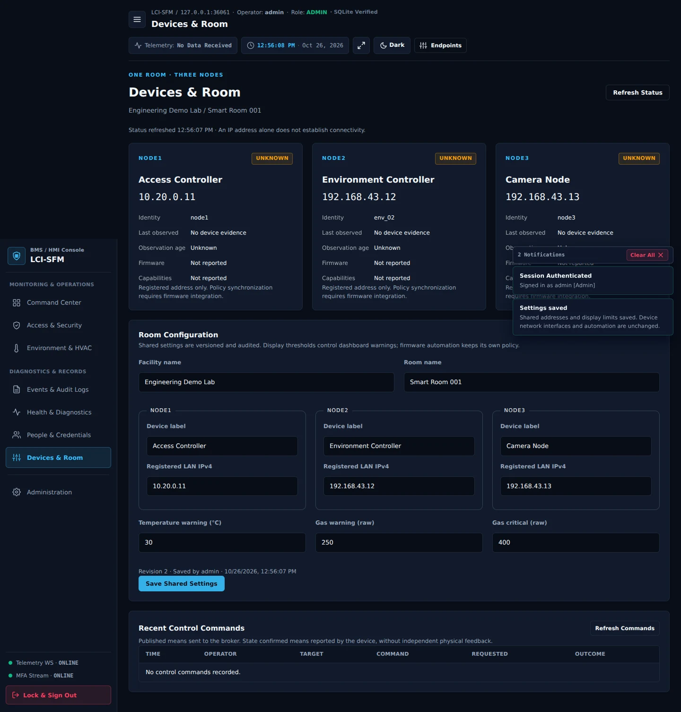
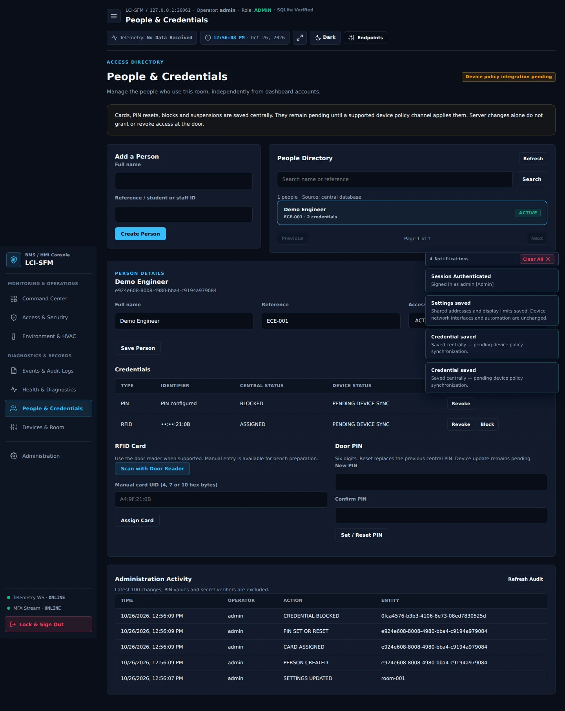
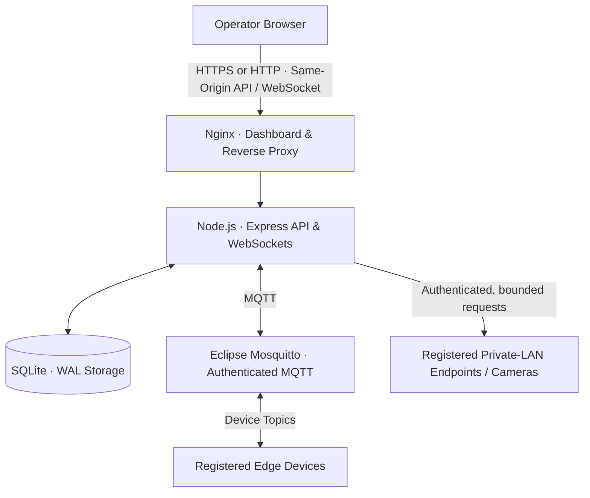

<div align="center">

# LCI-SFM
### Smart Facility Management System

**A local-first platform for managing rooms, connected devices, endpoints, and day-to-day facility operations.**

[](https://github.com/AbdullahNSarhan/Smart-Facility-Management-System)
[](https://nodejs.org/)
[](https://docs.docker.com/compose/)

[Features](#features) · [Screenshots](#screenshots) · [Architecture](#architecture) · [Installation](#installation) · [Using the Dashboard](#using-the-dashboard) · [Documentation](#documentation)

</div>

---

## Overview

LCI-SFM (Light Current Infrastructure – Smart Facility Management) is an on-premises facility management platform designed to bring room management, connected-device monitoring, and operational activities into one dashboard.

The system organizes a facility into **Rooms → Devices → Endpoints**. Operators can review device health, inspect endpoint readings, follow telemetry history, manage alarms and notifications, and administer facility users—all through a browser-based interface hosted on the local network.

LCI-SFM is designed around a **local-first** deployment model. Its frontend, backend, database, and MQTT broker run on infrastructure controlled by the facility. The browser uses same-origin application APIs and WebSockets; it does not need third-party UI CDNs or remote font services.

> **Release status:** `2.0.0-rc.1` is a software release candidate. The application and its software validation workflows are available; physical device/firmware commissioning and site-specific acceptance must still be completed for the target installation.

## Features

| Area | What it provides |
|---|---|
| **Facility overview** | A central dashboard for room summaries, device status, service readiness, and recent activity. |
| **Room management** | Create, edit, inspect, and archive rooms, then organize devices by their assigned room. |
| **Device management** | Register and inspect devices, maintain their metadata and registered network destinations, and review pending device announcements. |
| **Generic endpoints** | Display supported sensor readings, Boolean states, switches, access states, and camera snapshots using endpoint-specific widgets. |
| **Live monitoring** | Follow device connectivity, endpoint freshness, telemetry history, and device activity. |
| **Alarms & rules** | Configure supported sensor threshold/Boolean rules, review alarm history, acknowledge alarms, and inspect recovery events. |
| **Notification Center** | View persistent, user-scoped notifications, unread counts, and read states. |
| **Network topology** | Inspect the facility's registered devices and their connectivity from an interactive topology view. |
| **Events & audit history** | Review operational events, commands, access/camera events, and available audit records. |
| **People & operator accounts** | Manage facility people and dashboard accounts separately, with Admin/Viewer access roles and credential administration. |
| **Camera & device operations** | Use the authenticated camera snapshot flow and supported device command workflows. |
| **Local deployment** | Deploy with Docker Compose, use optional local HTTPS, or prepare a verified offline deployment bundle. |

### Supported endpoint capabilities

The current endpoint engine supports these combinations:

| Endpoint kind | Supported data types | Dashboard behavior |
|---|---|---|
| `SENSOR` | `NUMBER`, `BOOLEAN` | Readings, freshness, history, and supported sensor alarm rules |
| `SWITCH` | `ENUM`, `BOOLEAN` | Supported switch controls and reported state |
| `ACCESS` | `ENUM` | Door/access state display |
| `CAMERA` | `MEDIA`, `BOOLEAN` | Camera state and authenticated JPEG snapshot preview |

New transports or endpoint capabilities require a matching backend adapter, validation, command/safety handling where applicable, and tests. Registering an arbitrary device does not automatically make every hardware protocol compatible.

## Screenshots

A look at the current management interface:

| Room devices | People & credentials |
|---|---|
|  |  |

## Architecture

LCI-SFM is composed of three application services plus its persistent data and connected device layer.



| Component | Responsibility |
|---|---|
| **Frontend** | Browser SPA built with HTML, CSS, and vanilla JavaScript ES modules; bundled locally by Vite. |
| **Nginx** | Serves the compiled dashboard and reverse-proxies application API and WebSocket traffic. |
| **Backend** | Node.js and Express application handling authentication, facility logic, device registry, monitoring, and APIs. |
| **Database** | SQLite with write-ahead logging (WAL) for persistent application records. |
| **MQTT broker** | Eclipse Mosquitto with authenticated identities and access-control rules for connected devices. |
| **Edge devices** | Controllers and devices connected over the facility's private network using supported integrations. |

## Technology Stack

- **Frontend:** HTML5, CSS3, JavaScript ES Modules, Vite, local SVG assets.
- **Backend:** Node.js, Express, WebSockets, Zod validation.
- **Database:** SQLite (WAL).
- **Messaging:** MQTT 5 client library and Eclipse Mosquitto.
- **Deployment:** Docker Engine, Docker Compose, Nginx.
- **Testing:** Node.js test runner and Playwright UI checks.

## Installation

### Option 1 — Guided installation on Ubuntu (recommended)

The guided installer prepares the application under `/opt/lci-sfm`, installs Docker/Compose when they are missing, creates protected local configuration and credentials on first installation, and deploys the application services.

**Requirements**
- A supported 64-bit Ubuntu Server installation.
- A user with `sudo` privileges.
- Internet access during the initial installation to retrieve the repository, packages, and container images.
- A suitable private LAN address for the server.

Run the installer:

```bash
installer="$(mktemp)" &&
curl -fsSL "https://raw.githubusercontent.com/AbdullahNSarhan/Smart-Facility-Management-System/main/install.sh" -o "$installer" &&
sudo bash "$installer"
status=$?
rm -f "$installer"
exit "$status"
```

The installer guides you through the deployment choices, including the dashboard bind address, ports, optional local HTTPS, MQTT network exposure, and the initial administrator username.

When installation completes:

1. Open the dashboard using the server address and URL scheme reported by the installer. The default dashboard port is **80**; local HTTPS uses the configured TLS option.
2. Retrieve the generated initial administrator details from `/opt/lci-sfm/DEPLOYMENT-CREDENTIALS.txt`.
3. Keep that file private. It is created with restricted permissions; do not upload it, share it publicly, or commit it to Git.
4. Sign in and change the initial administrator password.

The installer preserves an existing `.env` during subsequent runs. Review the [Deployment Guide](docs/DEPLOYMENT_GUIDE.md) before changing an existing installation.

### Option 2 — Run locally for development

**Requirements:** Git, Node.js `22.5.0` or newer (Node.js 24 is recommended), and npm.

Clone the repository and install dependencies:

```bash
git clone https://github.com/AbdullahNSarhan/Smart-Facility-Management-System.git
cd Smart-Facility-Management-System
npm ci
```

Build the frontend and start the local backend:

```bash
npm run build
MQTT_ENABLED=false npm run dev
```

Open:

```text
http://localhost:3000
```

This mode is suitable for local application development and software review. MQTT-connected hardware workflows require the broker and the relevant device configuration.

### Option 3 — Offline deployment

For environments without Internet access, create an offline release bundle on a connected build machine:

```bash
npm ci
npm run bundle:offline
```

Transfer the generated archive and its SHA-256 checksum to the target Ubuntu server, verify the checksum, extract the archive, and run its `install-offline.sh` installer. The target server must already have Docker Engine and the Docker Compose v2 plugin.

See the [Deployment Guide](docs/DEPLOYMENT_GUIDE.md) for the complete offline installation and upgrade procedure.

## Using the Dashboard

After signing in, the main workflow is:

1. **Set up the facility:** Open **Rooms** and create the rooms or zones you need.
2. **Register devices:** Open **Devices** and add a device with its identity, room, transport, and supported endpoint definitions.
3. **Connect supported MQTT devices:** Provision a device-specific broker identity on the server, configure the device with its credentials, and verify that it reports to the broker. Unknown announcements can be reviewed by an Admin in the pending-device area.

   Example for a device named `lab305-env-01`:

   ```bash
   sudo ./scripts/provision-mqtt-device.sh add --device-id lab305-env-01 --username lab305-env-01
   ```

   Deliver the generated device credentials securely to the device. Never place passwords in source code, screenshots, or public documentation.
4. **Monitor endpoints:** Open a device to inspect its supported endpoint widgets, connectivity, freshness, and recent observations. Select an endpoint to view its available history.
5. **Review alarms and notifications:** Use **Alarms** to review rule-based events and **Notifications** to follow your operator inbox.
6. **Inspect operations:** Use **Network**, **Events**, and **Diagnostics** to review connectivity and operational activity.
7. **Manage people and access:** Admins can manage dashboard operators, facility people, credentials, and facility settings in the administration pages.

The available actions depend on the operator's role and the connected device's supported capabilities.

## Security & Deployment Notes

- Deploy the default HTTP configuration only on a trusted private LAN. Configure and verify HTTPS/TLS before using the dashboard over an untrusted network.
- Keep `.env`, `DEPLOYMENT-CREDENTIALS.txt`, `mosquitto/passwd`, device credential files, database backups, and TLS private keys out of source control.
- MQTT anonymous access is disabled; use individual device identities and the supplied provisioning workflow.
- The browser communicates with the application backend; MQTT broker credentials are not exposed to browser code.
- Changing a device's registered IP updates the server-side destination record. It does **not** reconfigure the physical device's network interface.
- Camera snapshots are proxied through the authenticated backend. Snapshot support does not by itself provide face recognition or biometric verification.
- Physical access-policy synchronization and device-specific firmware behavior require matching firmware integration and on-site validation.

## Validation

Run the main software checks from the repository root:

```bash
npm run lint
npm test
npm run build
npm run test:ui
npm run test:load
```

| Command | Purpose |
|---|---|
| `npm run lint` | JavaScript syntax validation across the application and scripts. |
| `npm test` | Backend, authentication, management, MQTT, and integration tests. |
| `npm run build` | Production frontend bundle generated in `dist/`. |
| `npm run test:ui` | Browser-based UI, responsive layout, and offline-request checks. |
| `npm run test:load` | Facility and telemetry scale/concurrency test. |

## Documentation

For deeper technical and operational details:

- [Deployment Guide](docs/DEPLOYMENT_GUIDE.md) — guided installation, configuration, TLS, offline deployment, and backup/restore.
- [Local-First Architecture](docs/LOCAL_FIRST_ARCHITECTURE.md) — components, data hierarchy, and application routes.
- [Facility Management Guide](docs/FACILITY_MANAGEMENT.md) — room, device, people, and credential workflows.
- [Capability Registry](docs/CAPABILITY_REGISTRY.md) — supported endpoint kinds, data types, transports, and freshness behavior.
- [MQTT Protocol Specification](docs/MQTT_PROTOCOL_SPEC.md) — device topics, message contracts, and broker identity model.
- [Frontend Documentation](docs/FRONTEND_DOCUMENTATION.md) — frontend structure, routes, and interface behavior.
- [Release Checklist](docs/RELEASE_CHECKLIST.md) — release status and acceptance boundaries.
- [Changelog](CHANGELOG.md) — notable project changes.

---

<div align="center">

**LCI-SFM — Smart Facility Management, hosted on your own infrastructure.**

</div>
