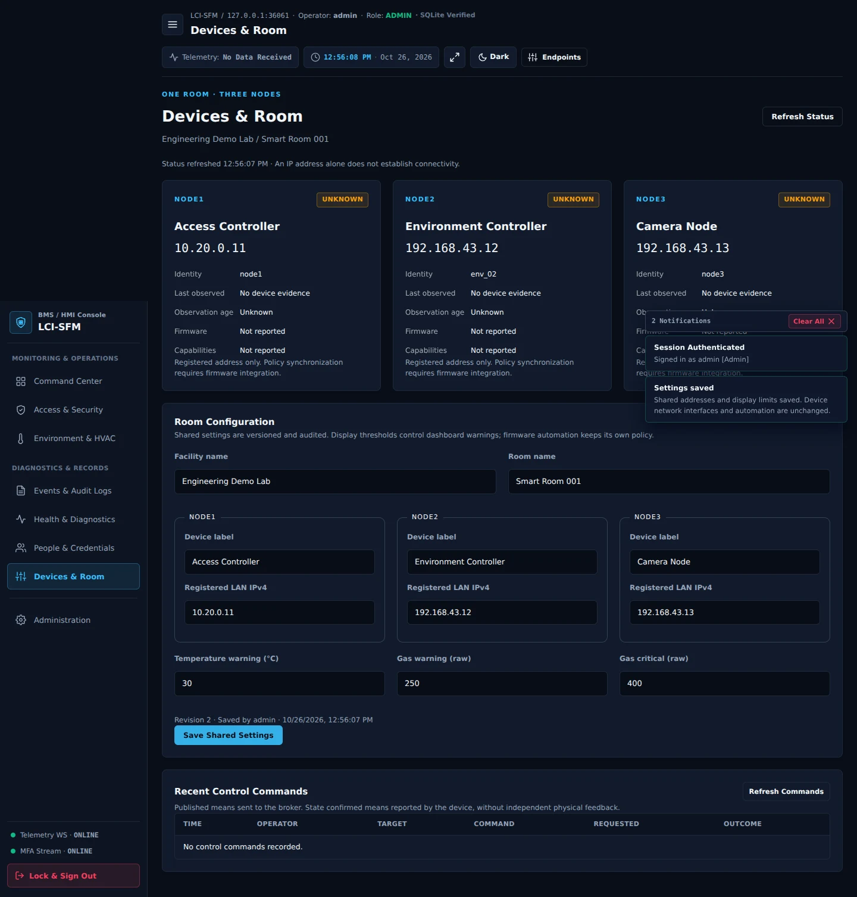
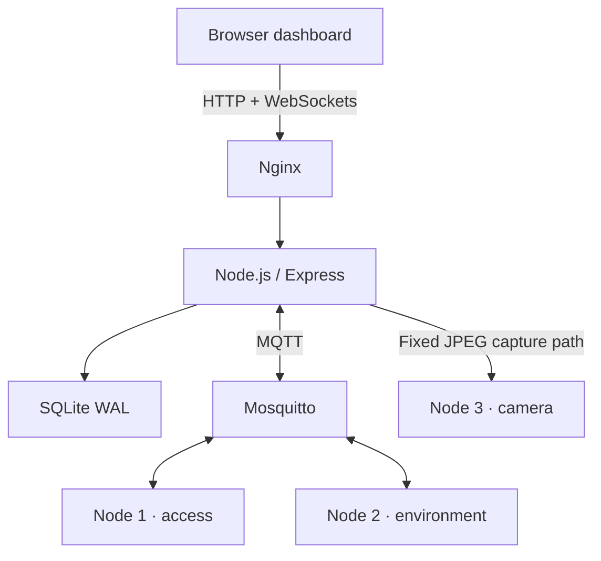

# LCI-SFM · Smart Facility Management

**A local operations console for one smart room, one door and three wired edge nodes.**

LCI-SFM — *Light Current Infrastructure for Smart Facility Management* — connects access control, environmental monitoring and camera capture to a shared dashboard. The graduation demonstrator runs on a local server, with an architecture that can accommodate more rooms later.

The browser uses the Node.js API; SQLite owns persistent records; Mosquitto carries device messages. Device firmware owns local execution and reports its results. The dashboard distinguishes a saved record, a published command and a device-reported state.

## What you can manage

| Area | Capabilities |
|---|---|
| Operations | Live telemetry, historical trends, access events and system diagnostics |
| People | Create and edit people, search and paginate the directory, suspend/reactivate authorization |
| Physical credentials | Assign cards manually or through a compatible door reader; set/reset six-digit PINs; block or revoke credentials |
| Dashboard accounts | Separate Admin and Viewer accounts, independent passwords, role changes and last-admin protection |
| Devices | Three-node registry, names and private LAN addresses, last observation, freshness, reported firmware and capabilities |
| Shared settings | Facility/room names, node addresses and dashboard warning thresholds; persisted centrally with revision checks |
| Controls | Existing allowlisted door, fan, light and control-mode commands, with command history and correlated acknowledgements |
| Camera | Authenticated backend JPEG proxy using the registered Node 3 address; no browser-to-camera route required |
| Accountability | Administration audit, access/event explorer, filters and CSV export for existing event tables |
| Deployment | Docker Compose, Ubuntu installer/updater, SQLite backup/restore and automated software checks |

### Implementation boundaries

| Capability | Current evidence / limit |
|---|---|
| Shared configuration, people and credentials | Implemented and covered by automated backend tests |
| Reader enrollment | Server/UI flow implemented; real reader must implement and advertise `RFID_ENROLL_V1` |
| Credential/device policy synchronization | **Pending firmware integration.** Assignments, PIN resets, blocks and suspensions do not update a physical reader yet |
| Node IP editing | Changes the **registered address** in SQLite and the running backend. Does not change the device's static IP, DHCP lease, gateway or subnet |
| Fan/light/door control | MQTT command coordination exists; requires compatible device firmware. A reported state is not independent physical feedback |
| Sensor measurements | Displayed with freshness. MQ-2 values are uncalibrated **raw readings**, not certified gas PPM |
| Face recognition/enrollment | Camera capture is available; a complete Vision service, biometric enrollment and liveness are not deployed |
| Multi-room operation | Future extension. This release manages exactly one room, one door and three nodes |

See [Management Guide](docs/FACILITY_MANAGEMENT.md) for workflows, API contracts, upgrade behavior and the selected roadmap.

## Console preview

The screenshots use sample records and disconnected hardware; UNKNOWN is intentional.



[People and credentials preview](docs/screenshots/people-credentials.webp)

## Architecture



The frontend uses HTML, CSS and vanilla JavaScript modules, bundled locally by Vite. Runtime assets use no CDN. Browser code contains no MQTT credentials. Dashboard accounts (`system_users`) and physical occupants (`people`, `physical_credentials`) are separate domains.

## Run locally

Requirements: **Node.js 24 recommended**, npm, and Git. Node.js must support built-in `node:sqlite` (minimum declared version: 22.5).

```bash
git clone https://github.com/AbdullahNSarhan/Smart-Facility-Management-System.git
cd Smart-Facility-Management-System
npm ci
npm run dev
```

Open **http://localhost:3000**. Fresh development databases bootstrap username `admin` with password `LCI-Dev-Admin-2026!`, unless overridden by `LCI_BOOTSTRAP_ADMIN_USERNAME` / `LCI_BOOTSTRAP_ADMIN_PASSWORD`. These are development credentials only.

For software-only exploration without a broker:

```bash
MQTT_ENABLED=false npm run dev
```

Missing devices remain unknown; software-only mode does not manufacture telemetry or acknowledge hardware commands. Do not copy `.env.example` unchanged before development: production checks intentionally reject placeholder secrets.

## First configuration

1. Sign in as Admin and open **Devices & Room**.
2. Set facility/room names, device labels and each device's private LAN IPv4 address. Addresses must be distinct; the registry currently accepts RFC1918 addresses with a host octet from 1–254.
3. Save shared settings. A revision conflict means another operator saved first: refresh the page, review their values and retry.
4. Configure each physical device or DHCP reservation to match its registered address. MQTT routing still uses server-configured device IDs and allowlisted topics.
5. Open **People & Credentials**, create a person and assign credentials. Their device state remains **pending** until a policy channel is implemented and tested.
6. Use **Administration** to create independent dashboard accounts. A door PIN is never used as the dashboard password in this workflow.

The quick endpoint dialog and Administration IP form use the same shared node registry. The **Central Gateway Host** is a browser-specific connection preference; changing it ends the current console session and requires signing in to the selected server.

## Validation

```bash
npm test                 # Backend/auth/MQTT/management/camera boundary integration tests
npm --prefix backend test
npm run lint             # JavaScript syntax validation
npm run build            # Production assets -> dist/
npm run db:backup        # See deployment guide for destination/options
npm run db:restore       # See deployment guide; stop application before restore
```

Tests cover CSRF/RBAC, revision conflicts, restart persistence, credential secrecy, PIN reset, reader ownership/nonce/expiry/replay handling, command correlation, camera response boundaries and deployment rollback. Software tests do not establish hardware reliability.

## Production deployment

The three-service Compose stack consists of **Nginx**, **Node.js** and **Mosquitto**. SQLite persists in a named volume. Nginx mounts only compiled `dist/` assets. Vision is not a fourth deployed service in this release.

### Existing Ubuntu automation

For a fresh Ubuntu server on a trusted private LAN:

```bash
curl -fsSL https://raw.githubusercontent.com/AbdullahNSarhan/Smart-Facility-Management-System/main/install.sh | sudo bash
```

The installer prepares dependencies, creates local production secrets, validates the application and starts Compose. Generated credentials stay in root-protected files under `/opt/lci-sfm`. Read [Deployment Guide](docs/DEPLOYMENT_GUIDE.md) before installation or connecting physical loads.

After changes have been merged into your deployment branch:

```bash
sudo /opt/lci-sfm/update.sh
```

The updater validates a candidate checkout, preserves configuration and persistent volumes, creates a verified online database backup when the backend is running, and attempts rollback after deployment/readiness failure. It refuses a dirty checkout. Do not use `docker compose down -v` to troubleshoot.

### Manual Compose setup

```bash
npm ci
npm run build
cp .env.example .env
chmod 600 .env
# Edit .env: replace all placeholders and configure private-LAN binding.
# Generate mosquitto/passwd using mosquitto/README.md before starting the broker.
docker compose config -q
docker compose up -d mqtt-service
docker compose up -d --build backend
docker compose up -d --build frontend_dashboard
docker compose ps
```

By default the example bind addresses are loopback. Configure actual private LAN binding and firewall rules when devices/workstations need access. The current HTTP/MQTT deployment assumes a trusted private network. Production secrets and TLS termination belong in deployment configuration, not browser settings.

## Default address map

| Component | Default |
|---|---|
| HTTP API | Same origin: `/api/*`; management: `/api/v1/*` |
| WebSockets | Same origin: `/ws/telemetry`, `/ws/mfa` |
| Access node | `node1` · `192.168.43.11` |
| Environment node | `env_02` · `192.168.43.12` |
| Camera node | `node3` · `192.168.43.13` |
| Browser snapshot endpoint | `/api/v1/devices/node3/snapshot` |

Environment variables seed the node registry **only on first database creation**. Once saved, SQLite settings take precedence across restarts. Editing an address does not change MQTT identity or topic permissions.

## Documentation

- [Facility Management & Feature Decisions](docs/FACILITY_MANAGEMENT.md) — current workflows, new endpoints, data migration and future priorities.
- [Deployment Guide](docs/DEPLOYMENT_GUIDE.md) — secrets, LAN setup, install/update, backup/restore.
- [Backend Architecture](docs/BACKEND_ARCHITECTURE.md) — original service architecture and command lifecycle.
- [Frontend Documentation](docs/FRONTEND_DOCUMENTATION.md) — dashboard views and existing integrations.
- [Pre-Hardware Interface Handoff](docs/PRE_HARDWARE_INTERFACE_HANDOFF.md) — MQTT/device acceptance conditions.
- [Mosquitto ACL Guide](mosquitto/README.md) — separate service/device credentials.
- [Hardware Reference](hardware_embedded_systems_architecture_reference_lci_sfm.md)
- [System Workflows](lci_sfm_comprehensive_workflows_system_logic.md)

The management guide supersedes older descriptions of browser-only node IPs and combined operator/person provisioning. Existing historical documents may describe proposed hardware behavior; code and physical acceptance evidence determine what currently works.
