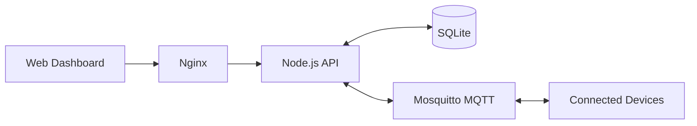

<div align="center">

# LCI-SFM
**Smart Facility Management System**

*One platform. Every room. Connected operations.*

[](https://github.com/AbdullahNSarhan/Smart-Facility-Management-System)
[](https://nodejs.org/)
[](https://docs.docker.com/compose/)

**A self-hosted, local-first platform to monitor and manage facility rooms, devices, endpoints, and operational activity.**

[Get Started](#get-started) · [Capabilities](#capabilities) · [Architecture](#architecture) · [Documentation](#documentation)

</div>

---

## About

LCI-SFM brings facility operations into one unified dashboard. Organize spaces, register connected devices, monitor their data, and manage alarms, notifications, and users from your own infrastructure.

Built for private networks, with an offline-ready frontend and a modular device integration layer.

## Capabilities

| **Facility** | **Monitoring** |
|---|---|
| Rooms, devices, and endpoint management | Live status, telemetry, and endpoint history |
| Device onboarding and network topology | Alarms, notifications, and event records |
| People, operators, and role-based access | Camera snapshots and supported device controls |

**Supported endpoint types:** Sensors · Switches · Access · Cameras

## Architecture



**Stack:** HTML · CSS · JavaScript · Node.js · Express · SQLite · MQTT · Docker Compose

## Get Started

### Ubuntu Server — guided installation

**Requirements:** 64-bit Ubuntu Server, `sudo` access, and Internet connectivity for the initial setup.

The installer prepares Docker, application configuration, local credentials, and the three-service deployment.

```bash
installer="$(mktemp)"
curl -fsSL "https://raw.githubusercontent.com/AbdullahNSarhan/Smart-Facility-Management-System/main/install.sh" -o "$installer"
sudo bash "$installer"
status=$?
rm -f "$installer"
exit "$status"
```

When setup completes, open the dashboard at the server address shown by the installer. Find the initial Admin credentials in `/opt/lci-sfm/DEPLOYMENT-CREDENTIALS.txt`, sign in, and change the initial password.

### Local development

**Requirements:** Git, Node.js `22.5.0+` (Node.js 24 recommended), and npm.

```bash
git clone https://github.com/AbdullahNSarhan/Smart-Facility-Management-System.git
cd Smart-Facility-Management-System
npm ci
npm run build
MQTT_ENABLED=false npm run dev
```

Open `http://localhost:3000`.

### Offline deployment

Build an offline package on a connected machine with `npm run bundle:offline`, then transfer and install it on an Ubuntu host with Docker Engine and the Docker Compose v2 plugin. Follow the [Deployment Guide](docs/DEPLOYMENT_GUIDE.md) for the checksum and installation steps.

## Daily Use

1. Create your facility rooms.
2. Register devices and their supported endpoints.
3. Connect compatible devices using their provisioned credentials.
4. Monitor live data, device health, alarms, and notifications.
5. Review events and manage users from the dashboard.

Available controls depend on the operator's role and each device's implemented capabilities.

## Security & Status

- Keep the dashboard on a trusted private network; configure HTTPS before exposing it to untrusted networks.
- Store credentials, `.env`, database files, backups, and TLS keys securely. Never commit them.
- MQTT access uses authenticated device identities; broker credentials are not exposed to the browser.
- A registered device IP changes the server's destination record—it does not configure the physical device.
- Release `2.0.0-rc.1` is a **software release candidate**. Site-specific hardware, firmware, and physical commissioning require separate validation.

## Quality Checks

```bash
npm run lint
npm test
npm run build
npm run test:ui
npm run test:load
```

## Documentation

| Guide | Description |
|---|---|
| [Deployment](docs/DEPLOYMENT_GUIDE.md) | Installation, configuration, TLS, offline setup, and backups |
| [Architecture](docs/LOCAL_FIRST_ARCHITECTURE.md) | System design and data structure |
| [Facility Management](docs/FACILITY_MANAGEMENT.md) | Rooms, devices, people, and credentials |
| [Capability Registry](docs/CAPABILITY_REGISTRY.md) | Supported endpoint types and transports |
| [MQTT Protocol](docs/MQTT_PROTOCOL_SPEC.md) | Device messaging and broker identities |
| [Frontend](docs/FRONTEND_DOCUMENTATION.md) | Dashboard structure and routes |
| [Release Checklist](docs/RELEASE_CHECKLIST.md) | Release scope and acceptance status |
| [Changelog](CHANGELOG.md) | Project updates |

---

<div align="center">

**LCI-SFM** · Smart facility operations, on your infrastructure.

</div>
