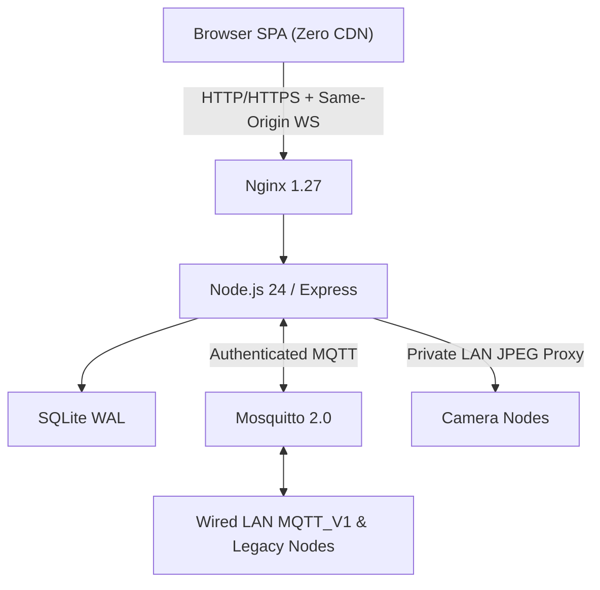

# LCI-SFM · Smart Facility Management

**2.0.0-rc.1 · Local-first, air-gapped-ready multi-room smart facility management platform with generic capability endpoints, multi-page operational console, and offline deployment engineering.**

Software release candidate: automated software, multi-page air-gap UI, and 20-room/100-device scale tests pass; target Ubuntu Server VM and physical hardware acceptance remain pending. See the [Local-First Architecture](docs/LOCAL_FIRST_ARCHITECTURE.md), [Deployment Test Results](docs/DEPLOYMENT_TEST_RESULTS.md), [Acceptance Checklist](docs/RELEASE_CHECKLIST.md), and [Changelog](CHANGELOG.md).

LCI-SFM — *Light Current Infrastructure for Smart Facility Management* — manages facilities as **Facility → Rooms → Devices → Generic Endpoints** over a private wired LAN. The browser communicates solely with the same-origin Node.js API and WebSocket gateway; SQLite WAL owns persistent records; Eclipse Mosquitto carries per-device authenticated MQTT messages. Edge devices retain autonomous local safety logic.

## What you can manage

| Area | Capabilities |
|---|---|
| Multi-room topology | Create, edit, archive, and inspect multiple rooms (`building`, `floor`, `room_code`) with room-scoped device grids and health summaries |
| Generic Endpoint Engine | Uses implemented endpoint kinds (`SENSOR`, `SWITCH`, `ACCESS`, `CAMERA`) with supported data types (`SENSOR: NUMBER/BOOLEAN`, `SWITCH: ENUM/BOOLEAN`, `ACCESS: ENUM`, `CAMERA: MEDIA/BOOLEAN`); new transports or capabilities still require a matching adapter and validation support |
| Multi-page console | Dedicated Local Landing (`/`), Login (`/login`), and Authenticated Operations Shell (`/app/overview`, `/app/rooms`, `/app/rooms/:id`, `/app/devices`, `/app/devices/:id`, `/app/devices/:id/endpoints/:key`, `/app/alarms`, `/app/notifications`, `/app/events`, `/app/diagnostics`, `/app/users`, `/app/settings`, `/app/profile`) with Dark Industrial Graphite default + Light toggle |
| Device onboarding & drift | Transport-conditional validation (`MQTT_V1` does not require a direct IPv4 address; `HTTP_JSON_V1` & `CAMERA_JPEG` require a private RFC1918 IPv4 address), Pending Device Quarantine from heartbeat capability announcements, and Manifest Drift alerts |
| Alarm management | User-configurable rules support numeric sensor limits (`THRESHOLD_HIGH`, `THRESHOLD_LOW`) and boolean sensor conditions (`BOOLEAN_TRUE`, `BOOLEAN_FALSE`), with dwell, hysteresis, acknowledgement timelines, and recovery evidence; stale-device alarms are generated separately by monitoring |
| Notification Center | Persistent scoped events, per-user unread count/read state, filters, WebSocket invalidation, and retention |
| People & credentials | Occupant directory, RFID/PIN management, independent dashboard accounts (`Admin`/`Viewer`), CSRF protection, and last-admin guard |
| Camera & controls | Authenticated SSRF-bounded JPEG capture proxy and correlated expiring MQTT switch/legacy commands |
| Local deployment & air-gap | Guided `install.sh` (`--discover-only` & Q1–Q6), safe Netplan static-IP helper, optional local HTTPS/TLS (`docker-compose.tls.yml`), host-side MQTT ACL CLI (`scripts/provision-mqtt-device.sh`), and SHA-256 verified offline bundles (`install-offline.sh`, `update-offline.sh`) |

### Implementation boundaries

| Capability | Current evidence / limit |
|---|---|
| Multi-room, generic endpoints, quarantine, alarms & RBAC | Implemented and verified across 64 backend tests, 14-route Playwright air-gap E2E (`external_requests: 0`), and 20-room/100-device/10,000-frame load test |
| Credential/device policy synchronization | **Pending firmware integration.** Assignments, PIN resets, blocks, and suspensions do not push policy to a physical reader yet |
| Node IP editing | Updates the **registered address** in SQLite. Does not reconfigure an edge device's network interface |
| Sensor measurements | Displayed with per-endpoint freshness (`FRESH` / `STALE` / `UNKNOWN`). MQ-2 values remain uncalibrated raw readings until lab calibrated |
| Face recognition/enrollment | Camera snapshot capture is available; a separate Vision/biometric service is not deployed in Compose |
| Hardware & VM commissioning | Physical edge devices, target Ubuntu Server clean install, and offline USB transfer remain pending on target hardware |

## Architecture



The frontend uses modular vanilla ES JavaScript (`/frontend/*`), CSS custom properties, and local inline SVG charts bundled into `dist/` by Vite. Runtime assets use zero CDNs or external fonts. Browser code never receives MQTT credentials.

## Try the isolated simulator

```bash
npm ci
npm run simulate
```

Open **http://127.0.0.1:3101**. Initial simulator-only account: `sim_admin` / `LCI-Simulator-Only-2026!`. A separate database and explicit simulation banner distinguish synthetic data from production.

## Run locally

Requirements: **Node.js 24 recommended** (minimum `22.5.0` for built-in `node:sqlite`), npm, and Git.

```bash
npm ci
npm run build
MQTT_ENABLED=false npm run dev
```

Open **http://localhost:3000**. Fresh development databases bootstrap `admin` / `LCI-Dev-Admin-2026!` unless overridden via `LCI_BOOTSTRAP_ADMIN_USERNAME` / `LCI_BOOTSTRAP_ADMIN_PASSWORD`.

## Validation

```bash
npm test                 # 64 automated backend/auth/MQTT/management/multi-room integration tests
npm run lint             # Syntax validation across frontend, backend, tests, and scripts
npm run build            # Production Vite bundle -> dist/
npm run test:ui          # 14-route Chromium E2E + zero-external-network air-gap verification
npm run test:load        # 20-room, 100-device, 500-endpoint, 10,000-frame scale & concurrency benchmark
npm run bundle:offline   # Build SHA-256 verified air-gapped deployment archive (.tar.gz)
npm run db:backup        # Online SQLite backup
npm run db:restore       # Restore SQLite backup (stop backend first)
```

## Production & air-gapped deployment

### One-command guided installation (Ubuntu Server)

Use this on a supported Ubuntu Server host with sudo access, a working LAN interface, and Internet access for the initial repository download, package installation, and container images. The installer downloads the project into `/opt/lci-sfm`, installs Docker/Compose when missing, generates protected local credentials, runs lint/tests/build, starts the three services, and waits for application readiness.

```bash
tmp="$(mktemp)" && curl -fsSL 'https://raw.githubusercontent.com/AbdullahNSarhan/Smart-Facility-Management-System/main/install.sh' -o "$tmp" && sudo bash "$tmp"; status=$?; [ -z "${tmp:-}" ] || rm -f "$tmp"; exit "$status"
```

The installer is interactive when run from a terminal. Select the server's intended LAN IPv4 address for the Dashboard. At the MQTT exposure question, answer **yes** when ESP32/edge nodes must connect from the wired LAN; the secure default is loopback-only. Keep the server address stable (prefer a DHCP reservation or a preconfigured static address). Initial Admin credentials are saved in `/opt/lci-sfm/DEPLOYMENT-CREDENTIALS.txt` with mode `0600` and displayed at the end.

To inspect the host without installing anything, run `bash install.sh --discover-only` from a cloned repository.

The three-service Compose stack runs **Nginx** (`nginx:1.27-alpine`), **Node.js** (non-root), and **Mosquitto** (`eclipse-mosquitto:2.0`) with `no-new-privileges:true` and persistent Docker volumes (`sqlite_data`, `mosquitto_data`).

### Guided Ubuntu installation

```bash
# 1. Read-only host & network inspection
bash install.sh --discover-only

# 2. Optional safe static IPv4 configuration (Netplan with `netplan try` rollback)
sudo ./scripts/configure-static-ip.sh --discover

# 3. Guided Q1–Q6 installation (or --non-interactive)
sudo ./install.sh
```

### Optional local HTTPS / TLS mode

```bash
sudo ./scripts/setup-local-tls.sh <SERVER_LAN_IP> [HOSTNAME]
# Then set TLS_ENABLED=true, SESSION_SECURE_COOKIE=true,
# and ALLOWED_ORIGINS=https://<SERVER_LAN_IP> in .env before starting Compose.
docker compose -f docker-compose.yml -f docker-compose.tls.yml up -d
```

### Air-gapped offline bundle deployment

```bash
# On connected build workstation:
npm run bundle:offline

# The target host must already have Docker Engine and the Docker Compose v2 plugin.
# Transfer dist-offline/lci-sfm-2.0.0-rc.1-offline.tar.gz (+ .sha256) to offline Ubuntu server:
sha256sum -c lci-sfm-2.0.0-rc.1-offline.tar.gz.sha256
tar -xzf lci-sfm-2.0.0-rc.1-offline.tar.gz
cd lci-sfm-2.0.0-rc.1-offline
sudo ./install-offline.sh          # Fresh install
# or sudo ./update-offline.sh      # Guarded offline upgrade with rollback
```

### Per-device MQTT credential & ACL provisioning

```bash
sudo ./scripts/provision-mqtt-device.sh add --device-id lab305-env-01 --username lab305-env-01
```

## Documentation

- [Local-First Architecture](docs/LOCAL_FIRST_ARCHITECTURE.md) — system topology, multi-room hierarchy, routes, and health semantics.
- [MQTT Protocol Spec (v1)](docs/MQTT_PROTOCOL_SPEC.md) — topic namespace, heartbeat capability announcements, telemetry, command/ACK schemas, and CLI provisioning.
- [Capability & Endpoint Registry](docs/CAPABILITY_REGISTRY.md) — generic endpoint kinds, data types, freshness states, and widget engine.
- [Professional Local Platform Audit](docs/PROFESSIONAL_LOCAL_PLATFORM_AUDIT.md) — security posture, resolved gaps, and boundaries.
- [Deployment Guide](docs/DEPLOYMENT_GUIDE.md) — guided installer, static IP, local TLS, offline bundles, backup/restore, and troubleshooting.
- [Deployment Test Plan](docs/DEPLOYMENT_TEST_PLAN.md) & [Deployment Test Results](docs/DEPLOYMENT_TEST_RESULTS.md) — verified software/scale results and pending hardware tests.
- [Release Acceptance Checklist](docs/RELEASE_CHECKLIST.md) — 2.0.0-rc.1 software sign-off and physical commissioning checklist.
- [Facility Management Guide](docs/FACILITY_MANAGEMENT.md) & [Release Candidate Guide](docs/RELEASE_CANDIDATE_GUIDE.md) — workflows and legacy compatibility context.
- [Mosquitto ACL Guide](mosquitto/README.md) — broker identity rules.

