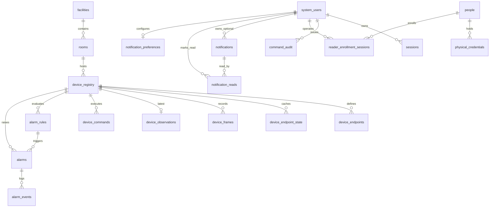

# Database Documentation — LCI-SFM

## 1. Database Engine & Runtime Configuration

LCI-SFM uses **SQLite** via Node.js's built-in synchronous `node:sqlite` module (`DatabaseSync`), eliminating external C++ native addons (`better-sqlite3`, `sqlite3`) and external database containers.

### Engine Initialization (`backend/src/config/database.js`)

When `openDatabase()` runs in [database.js](file:///opt/lci-sfm/backend/src/config/database.js):
1. Creates the parent directory (`data/` by default, or `/app/data` inside `lci_backend`) if missing.
2. Opens `<DB_PATH>` (default `/app/data/lci_sfm.sqlite` in Docker, `./data/lci_sfm.sqlite` locally; `:memory:` supported in tests).
3. Applies connection-level PRAGMAs:
   - `PRAGMA foreign_keys = ON;` — enforces relational integrity and `ON DELETE CASCADE` / `ON DELETE SET NULL`.
   - `PRAGMA busy_timeout = 5000;` — waits up to 5 seconds on write lock contention.
   - `PRAGMA journal_mode = WAL;` — enables Write-Ahead Logging for concurrent reads alongside serialized writes (for file-backed DBs).
   - `PRAGMA synchronous = NORMAL;` — balances durability and fsync latency under WAL mode.
4. Executes forward-only SQL migrations from [backend/src/migrations/](file:///opt/lci-sfm/backend/src/migrations) in lexicographical filename order inside `BEGIN IMMEDIATE ... COMMIT` transactions, recording applied filenames in `schema_migrations`.
5. Seeds initial state idempotently (`seedDefaults()` in [sqliteRepository.js](file:///opt/lci-sfm/backend/src/repositories/sqliteRepository.js) and `ensureSeeded()` in [releaseOperations.js](file:///opt/lci-sfm/backend/src/services/releaseOperations.js)).

### Concurrency, Transactions, Backup & Shutdown

- **Transaction Helper (`runInTransaction`)**: Wraps multi-statement mutations in `BEGIN IMMEDIATE` / `COMMIT` with automatic `ROLLBACK` on error, acquiring the write lock upfront to prevent mid-transaction `SQLITE_BUSY` deadlocks.
- **Graceful Shutdown**: On `SIGTERM`/`SIGINT`, [server.js](file:///opt/lci-sfm/backend/src/server.js) closes the database via `closeDatabase()`, which runs `PRAGMA wal_checkpoint(TRUNCATE)` before `db.close()`.
- **Online Backup & Restore** ([backup.js](file:///opt/lci-sfm/backend/src/config/backup.js), [db-backup.mjs](file:///opt/lci-sfm/scripts/db-backup.mjs), [db-restore.mjs](file:///opt/lci-sfm/scripts/db-restore.mjs)):
  - **Backup**: Uses `VACUUM INTO '<target>'` to produce a consistent, compacted snapshot while the database is online, runs `PRAGMA integrity_check` on the resulting file, and sets permissions to `0600`.
  - **Restore**: Verifies `PRAGMA integrity_check` on the candidate snapshot, takes a pre-restore safety copy if an active database exists, removes stale `-wal` and `-shm` sidecars, and atomically replaces the database file (`0600`).

---

## 2. Migration History

All 4 migrations are applied on the live production instance (`latest_migration: "004_multi_room_platform.sql"`):

| Order | File | Purpose | Tables Created / Altered |
| :--- | :--- | :--- | :--- |
| 1 | [001_initial_schema.sql](file:///opt/lci-sfm/backend/src/migrations/001_initial_schema.sql) | Core v1 schema: operator auth, sessions, legacy edge event/telemetry logs, system errors, command audit | Creates 8 tables (`schema_migrations`, `system_users`, `sessions`, `access_logs`, `camera_events`, `environmental_telemetry`, `system_errors`, `command_audit`) |
| 2 | [002_facility_management.sql](file:///opt/lci-sfm/backend/src/migrations/002_facility_management.sql) | Facility settings, physical access subjects (`people`), RFID/PIN credentials, reader enrollment, management audit | Creates 5 tables (`facility_settings`, `people`, `physical_credentials`, `management_audit`, `reader_enrollment_sessions`) |
| 3 | [003_release_operations.sql](file:///opt/lci-sfm/backend/src/migrations/003_release_operations.sql) | Release v1.1 operational platform: device registry, endpoints, telemetry frames, observations, commands, alarm rules/alarms, notifications, SQLite triggers, retention | Creates 11 tables (`device_registry`, `device_endpoints`, `device_frames`, `device_observations`, `device_commands`, `alarm_rules`, `alarms`, `alarm_events`, `notifications`, `notification_reads`, `notification_preferences`, `release_settings` = 12 tables total in 003; see full inventory below) + 5 SQLite triggers |
| 4 | [004_multi_room_platform.sql](file:///opt/lci-sfm/backend/src/migrations/004_multi_room_platform.sql) | Multi-room platform v2.0: facilities, rooms, per-endpoint state cache, pending MQTT device onboarding, typed endpoints & alarm conditions | Creates 4 tables (`facilities`, `rooms`, `device_endpoint_state`, `pending_devices`) and `ALTER`s `device_registry`, `device_endpoints`, and `alarm_rules` |

> **Total Table Count:** **30 tables** (including `schema_migrations`) + **5 SQLite triggers**.

---

## 3. Entity-Relationship Overview

> **Schema Relationship Note:** `device_registry.room_id` was added via `ALTER TABLE` in [004_multi_room_platform.sql](file:///opt/lci-sfm/backend/src/migrations/004_multi_room_platform.sql#L26) as `TEXT` (indexed by `idx_device_room`) without a SQLite `REFERENCES rooms(room_id)` constraint because SQLite `ALTER TABLE ADD COLUMN` cannot add foreign keys without table recreation; referential checks are enforced in [releaseOperations.js](file:///opt/lci-sfm/backend/src/services/releaseOperations.js).

---

## 4. Complete Table & Schema Reference

### 4.1 Core Auth, Sessions & Legacy Telemetry (`001_initial_schema.sql`)

#### 1. `schema_migrations`
Tracks applied SQL migration files.
- `version TEXT PRIMARY KEY` — migration filename (e.g., `004_multi_room_platform.sql`).
- `applied_at TEXT NOT NULL` — ISO-8601 UTC timestamp.

#### 2. `system_users`
Web dashboard operator accounts (`Admin` and `Viewer`).
- `id INTEGER PRIMARY KEY AUTOINCREMENT`
- `username TEXT NOT NULL UNIQUE COLLATE NOCASE`
- `role TEXT NOT NULL CHECK (role IN ('Admin', 'Viewer'))`
- `password_hash TEXT NOT NULL` — `scrypt` PHC string (`$scrypt$n=16384,r=8,p=1$...`).
- `pin_verifier TEXT` — optional legacy `scrypt` PIN verifier.
- `pin_configured INTEGER NOT NULL DEFAULT 0 CHECK (pin_configured IN (0, 1))`
- `rfid TEXT UNIQUE` — optional legacy RFID UID.
- `face_linked INTEGER NOT NULL DEFAULT 0 CHECK (face_linked IN (0, 1))`
- `enabled INTEGER NOT NULL DEFAULT 1 CHECK (enabled IN (0, 1))`
- `provisioning_status TEXT NOT NULL DEFAULT 'provisioned'`
- `created_at TEXT NOT NULL`, `updated_at TEXT NOT NULL`
- **Indexes**: `idx_system_users_role_enabled(role, enabled)`.

#### 3. `sessions`
Server-side web authentication sessions backing the `HttpOnly` `lci_session` cookie.
- `id TEXT PRIMARY KEY` — random UUID/hex session identifier.
- `token_verifier TEXT NOT NULL UNIQUE` — SHA-256 hex digest of the raw bearer/cookie secret.
- `csrf_token TEXT NOT NULL` — per-session CSRF token required in `X-CSRF-Token` on cookie-authenticated mutations.
- `user_id INTEGER NOT NULL REFERENCES system_users(id) ON DELETE CASCADE`
- `created_at TEXT NOT NULL`, `last_seen_at TEXT NOT NULL`, `expires_at TEXT NOT NULL`, `revoked_at TEXT`
- `user_agent TEXT`, `ip_address TEXT`
- **Indexes**: `idx_sessions_token_verifier(token_verifier)`, `idx_sessions_user_id(user_id)`.

#### 4. `access_logs`
Audit log for both physical access control events (`lecf/node1/access_event`) and web operator authentication (`WEB_LOGIN`, `WEB_LOGOUT`).
- `id INTEGER PRIMARY KEY AUTOINCREMENT`
- `timestamp TEXT NOT NULL`, `node_id TEXT`, `boot_id TEXT`, `seq INTEGER`
- `username TEXT`, `modality TEXT`, `event TEXT NOT NULL`, `status TEXT NOT NULL`, `mfa_status TEXT`, `details TEXT`
- **Indexes**:
  - `idx_access_logs_dedup` — `UNIQUE(node_id, boot_id, seq) WHERE node_id IS NOT NULL AND boot_id IS NOT NULL AND seq IS NOT NULL` (idempotent edge replay deduplication).
  - `idx_access_logs_timestamp(timestamp DESC)`.

#### 5. `camera_events`
Vision/MFA verification events received on `lecf/vision/mfa_result`.
- `id INTEGER PRIMARY KEY AUTOINCREMENT`
- `timestamp TEXT NOT NULL`, `node_id TEXT`, `boot_id TEXT`, `seq INTEGER`
- `event TEXT NOT NULL`, `user_id TEXT`, `status TEXT NOT NULL`, `confidence REAL`, `details TEXT`
- **Indexes**: `idx_camera_events_dedup` (partial unique on `node_id, boot_id, seq`), `idx_camera_events_timestamp(timestamp DESC)`.

#### 6. `environmental_telemetry`
Legacy environmental sensor history ingested from `lecf/env/telemetry` (and dual-written by `MQTT_V1` telemetry when numeric temperature/humidity/gas endpoints match).
- `id INTEGER PRIMARY KEY AUTOINCREMENT`
- `timestamp TEXT NOT NULL`, `timestamp_ms INTEGER NOT NULL`
- `node_id TEXT NOT NULL`, `boot_id TEXT`, `seq INTEGER`
- `temperature REAL NOT NULL`, `humidity REAL NOT NULL`, `smoke_gas_level REAL NOT NULL`
- `light_state TEXT NOT NULL CHECK (light_state IN ('ON', 'OFF'))`
- `fan_relay TEXT NOT NULL CHECK (fan_relay IN ('ON', 'OFF'))`
- `door_state TEXT NOT NULL CHECK (door_state IN ('OPEN', 'CLOSED'))`
- **Indexes**: `idx_env_telemetry_dedup` (partial unique on `node_id, boot_id, seq`), `idx_env_telemetry_timestamp(timestamp DESC)`, `idx_env_telemetry_timestamp_ms(timestamp_ms DESC)`.

#### 7. `system_errors`
Node diagnostics, malformed MQTT payload rejections, and edge fault reports.
- `error_id INTEGER PRIMARY KEY AUTOINCREMENT`
- `timestamp TEXT NOT NULL`, `source_node TEXT NOT NULL`, `error_code TEXT NOT NULL`, `severity TEXT NOT NULL`, `error_description TEXT NOT NULL`
- **Indexes**: `idx_system_errors_timestamp(timestamp DESC)`.

#### 8. `command_audit`
Lifecycle state machine table for legacy actuation commands (`POST /api/control/command` via [commandCoordinator.js](file:///opt/lci-sfm/backend/src/services/commandCoordinator.js)).
- `command_id TEXT PRIMARY KEY`, `request_id TEXT`
- `actor_user_id INTEGER REFERENCES system_users(id) ON DELETE SET NULL`, `actor_username TEXT NOT NULL`
- `command TEXT NOT NULL`, `requested_state TEXT NOT NULL`, `target_node TEXT NOT NULL`, `mqtt_topic TEXT NOT NULL`
- `lifecycle_state TEXT NOT NULL CHECK (lifecycle_state IN ('rejected', 'unavailable', 'published', 'acknowledged', 'state_confirmed', 'failed', 'timed_out'))`
- `issued_at TEXT NOT NULL`, `expires_at TEXT NOT NULL`, `acknowledged_at TEXT`, `confirmed_at TEXT`, `error_code TEXT`, `details TEXT`
- **Indexes**: `idx_command_audit_issued_at(issued_at DESC)`.

---

### 4.2 Facility Access & Credential Management (`002_facility_management.sql`)

#### 9. `facility_settings`
Singleton JSON document storing legacy facility profile metadata (`GET/PUT /api/v1/facility`).
- `id INTEGER PRIMARY KEY CHECK (id = 1)`
- `revision INTEGER NOT NULL DEFAULT 1` — optimistic concurrency version.
- `document TEXT NOT NULL` — JSON blob (`facilityName`, `siteCode`, `timezone`, etc.).
- `updated_at TEXT NOT NULL`, `updated_by TEXT NOT NULL`

#### 10. `people`
Physical facility personnel/access subjects (intentionally decoupled from `system_users` web login accounts).
- `subject_id TEXT PRIMARY KEY`
- `display_name TEXT NOT NULL`, `reference TEXT NOT NULL DEFAULT ''`
- `status TEXT NOT NULL DEFAULT 'ACTIVE' CHECK (status IN ('ACTIVE', 'SUSPENDED'))`
- `version INTEGER NOT NULL DEFAULT 1`, `created_at TEXT NOT NULL`, `updated_at TEXT NOT NULL`

#### 11. `physical_credentials`
RFID cards and keypad PINs assigned to `people`.
- `credential_id TEXT PRIMARY KEY`
- `subject_id TEXT NOT NULL REFERENCES people(subject_id)`
- `modality TEXT NOT NULL CHECK (modality IN ('RFID', 'PIN'))`
- `card_uid TEXT` — normalized uppercase hex UID (stored for RFID, `NULL` for PIN).
- `pin_verifier TEXT` — `scrypt` hash for PIN credentials (`NULL` for RFID; raw PINs are never stored).
- `status TEXT NOT NULL DEFAULT 'ASSIGNED' CHECK (status IN ('ASSIGNED', 'BLOCKED', 'REVOKED'))`
- `sync_status TEXT NOT NULL DEFAULT 'PENDING_DEVICE_SYNC' CHECK (sync_status = 'PENDING_DEVICE_SYNC')` — hard-constrained to `PENDING_DEVICE_SYNC` until edge credential sync is implemented.
- `created_at TEXT NOT NULL`, `updated_at TEXT NOT NULL`
- **Partial Unique Indexes**:
  - `idx_card_assignment` — `UNIQUE(card_uid) WHERE modality = 'RFID' AND status != 'REVOKED'` (prevents assigning one active RFID card to two people).
  - `idx_person_pin` — `UNIQUE(subject_id) WHERE modality = 'PIN' AND status != 'REVOKED'` (at most one active PIN per person).

#### 12. `management_audit`
Immutable administrative audit trail for operator, facility, person, credential, room, device, and alarm-rule mutations.
- `id INTEGER PRIMARY KEY AUTOINCREMENT`
- `timestamp TEXT NOT NULL`, `actor TEXT NOT NULL`, `action TEXT NOT NULL`, `entity_id TEXT NOT NULL`, `details TEXT NOT NULL` (JSON), `request_id TEXT`
- **Indexes**: `idx_management_audit_ts(timestamp DESC, id DESC)`.

#### 13. `reader_enrollment_sessions`
Tracks interactive RFID reader tap-to-enroll sessions (`ARMING` → `READY` → `CANDIDATE` → `CONFIRMED` / `CANCELLED` / `EXPIRED` / `FAILED`).
- `session_id TEXT PRIMARY KEY`
- `subject_id TEXT NOT NULL REFERENCES people(subject_id)`
- `operator_id INTEGER NOT NULL REFERENCES system_users(id) ON DELETE CASCADE`
- `device_id TEXT NOT NULL` (e.g. `node1`), `nonce_digest TEXT NOT NULL` (SHA-256 of enrollment session nonce)
- `status TEXT NOT NULL CHECK (status IN ('ARMING', 'READY', 'CANDIDATE', 'CONFIRMED', 'CANCELLED', 'EXPIRED', 'FAILED'))`
- `candidate_uid TEXT`, `expires_at TEXT NOT NULL`, `created_at TEXT NOT NULL`
- **Partial Unique Index**: `idx_reader_exclusive` — `UNIQUE(device_id) WHERE status IN ('ARMING', 'READY', 'CANDIDATE')` (enforces exclusive lock per physical reader).

---

### 4.3 Multi-Room Operations, Devices, Alarms & Notifications (`003` + `004`)

#### 14. `facilities` (`004`)
Multi-room facility metadata (`GET/PUT /api/v1/facility/profile`). Seeded with `facility_id = 'facility-default'`.
- `facility_id TEXT PRIMARY KEY`
- `name TEXT NOT NULL`, `description TEXT NOT NULL DEFAULT ''`, `location TEXT NOT NULL DEFAULT ''`, `timezone TEXT NOT NULL DEFAULT 'UTC'`
- `version INTEGER NOT NULL DEFAULT 1`, `created_at TEXT NOT NULL`, `updated_at TEXT NOT NULL`

#### 15. `rooms` (`004`)
Physical rooms/zones inside a facility (`/api/v1/rooms`). Seeded with `room_id = 'room-001'` (`room_code = 'ROOM-001'`, `'Main Facility Room'`).
- `room_id TEXT PRIMARY KEY`
- `facility_id TEXT NOT NULL REFERENCES facilities(facility_id)`
- `room_code TEXT NOT NULL` (normalized uppercase code, unique per facility)
- `name TEXT NOT NULL`, `description TEXT NOT NULL DEFAULT ''`, `building TEXT NOT NULL DEFAULT ''`, `floor TEXT NOT NULL DEFAULT ''`
- `status TEXT NOT NULL DEFAULT 'ACTIVE' CHECK (status IN ('ACTIVE', 'ARCHIVED'))`
- `version INTEGER NOT NULL DEFAULT 1`, `created_at TEXT NOT NULL`, `updated_at TEXT NOT NULL`
- **Constraints & Indexes**: `UNIQUE(facility_id, room_code)`, `idx_rooms_facility_status(facility_id, status)`.

#### 16. `device_registry` (`003` + `004` `ALTER TABLE`)
Authoritative inventory of edge nodes, sensors, relays, access controllers, and IP cameras.
- **Columns from `003`**:
  - `device_id TEXT PRIMARY KEY`
  - `slot INTEGER NOT NULL UNIQUE CHECK (slot >= 1)` — deterministic display/assignment slot.
  - `name TEXT NOT NULL`, `description TEXT NOT NULL DEFAULT ''`, `location TEXT NOT NULL DEFAULT ''`
  - `device_type TEXT NOT NULL CHECK (device_type IN ('SENSORS', 'CAMERA', 'ACCESS', 'RELAY', 'MIXED'))`
  - `transport TEXT NOT NULL CHECK (transport IN ('LEGACY_V1', 'MQTT_V1', 'HTTP_JSON_V1', 'CAMERA_JPEG'))`
  - `ip TEXT NOT NULL DEFAULT ''`, `port INTEGER NOT NULL DEFAULT 80 CHECK (port BETWEEN 1 AND 65535)`, `path TEXT NOT NULL DEFAULT '/'`
  - `enabled INTEGER NOT NULL DEFAULT 1 CHECK (enabled IN (0, 1))`
  - `stale_after_s INTEGER NOT NULL DEFAULT 30 CHECK (stale_after_s BETWEEN 5 AND 86400)`
  - `version INTEGER NOT NULL DEFAULT 1` — optimistic concurrency control (`If-Match` / `version`).
  - `maintenance_until TEXT`, `maintenance_reason TEXT`, `firmware_version TEXT`, `heartbeat_at TEXT`, `created_at TEXT NOT NULL`, `updated_at TEXT NOT NULL`
- **Columns added in `004`**:
  - `room_id TEXT` (indexed by `idx_device_room(room_id, archived_at)`)
  - `archived_at TEXT` (soft-archive timestamp; archived devices keep historical logs)
  - `protocol_version TEXT`, `capability_manifest_version TEXT`, `manifest_json TEXT`
  - `mqtt_identity_status TEXT NOT NULL DEFAULT 'UNPROVISIONED' CHECK (mqtt_identity_status IN ('UNPROVISIONED', 'PROVISIONED', 'LEGACY', 'NOT_APPLICABLE'))`
- **Partial Unique Index (`004` replacement)**:
  - `idx_device_address` — `UNIQUE(ip, port, path) WHERE enabled = 1 AND archived_at IS NULL AND ip != ''` (prevents duplicate active HTTP/camera network targets while allowing multiple `MQTT_V1` devices with empty `ip`).

#### 17. `device_endpoints` (`003` + `004` `ALTER TABLE`)
Capability descriptors per device (`PK(device_id, endpoint_key)`).
- **Columns from `003`**:
  - `device_id TEXT NOT NULL REFERENCES device_registry(device_id) ON DELETE CASCADE`
  - `endpoint_key TEXT NOT NULL`, `label TEXT NOT NULL`
  - `kind TEXT NOT NULL CHECK (kind IN ('SENSOR', 'SWITCH', 'CAMERA', 'ACCESS'))`
  - `unit TEXT NOT NULL DEFAULT ''`, `writable INTEGER NOT NULL DEFAULT 0 CHECK (writable IN (0, 1))`
- **Columns added in `004`**:
  - `description TEXT NOT NULL DEFAULT ''`
  - `data_type TEXT NOT NULL DEFAULT 'NUMBER' CHECK (data_type IN ('NUMBER', 'BOOLEAN', 'ENUM', 'MEDIA', 'STRING'))`
  - `readable INTEGER NOT NULL DEFAULT 1 CHECK (readable IN (0, 1))`
  - `retention_enabled INTEGER NOT NULL DEFAULT 1 CHECK (retention_enabled IN (0, 1))`
  - `min_value REAL`, `max_value REAL`, `allowed_values_json TEXT`, `display_config_json TEXT`, `command_profile TEXT`
  - `version INTEGER NOT NULL DEFAULT 1`

#### 18. `device_endpoint_state` (`004`)
Per-endpoint latest observed value cache (`PK(device_id, endpoint_key)`).
- `device_id TEXT NOT NULL REFERENCES device_registry(device_id) ON DELETE CASCADE`
- `endpoint_key TEXT NOT NULL`
- `last_value_json TEXT`, `last_seen_at TEXT NOT NULL`, `boot_id TEXT`, `seq INTEGER`

#### 19. `device_frames` (`003`)
Time-series history of ingested multi-endpoint telemetry frames (`UNIQUE(device_id, boot_id, seq)`).
- `id INTEGER PRIMARY KEY AUTOINCREMENT`
- `device_id TEXT NOT NULL REFERENCES device_registry(device_id) ON DELETE CASCADE`
- `boot_id TEXT NOT NULL`, `seq INTEGER NOT NULL`, `received_at TEXT NOT NULL`, `values_json TEXT NOT NULL`
- **Indexes**: `idx_device_frames_time(device_id, received_at DESC, id DESC)`.

#### 20. `device_observations` (`003`)
Per-device latest composite frame summary (`device_id PRIMARY KEY`).
- `device_id TEXT PRIMARY KEY REFERENCES device_registry(device_id) ON DELETE CASCADE`
- `boot_id TEXT`, `seq INTEGER`, `last_seen_at TEXT NOT NULL`, `values_json TEXT NOT NULL`

#### 21. `device_commands` (`003`)
Command lifecycle tracking for v1/v2 device endpoint actuation (`POST /api/v1/devices/:id/commands`).
- `command_id TEXT PRIMARY KEY`
- `device_id TEXT NOT NULL REFERENCES device_registry(device_id) ON DELETE CASCADE`
- `endpoint_key TEXT NOT NULL`, `requested_value TEXT NOT NULL`, `observed_value TEXT`
- `state TEXT NOT NULL CHECK (state IN ('QUEUED', 'SENT', 'ACKED', 'CONFIRMED', 'TIMED_OUT', 'FAILED', 'REJECTED'))`
- `actor TEXT NOT NULL`, `issued_at TEXT NOT NULL`, `expires_at TEXT NOT NULL`, `updated_at TEXT NOT NULL`, `error TEXT`
- **Indexes**: `idx_device_commands_device(device_id, issued_at DESC)`.

#### 22. `pending_devices` (`004`)
Quarantine table for unknown `MQTT_V1` nodes publishing announcements on `lci/v1/d/<device_id>/announce` before admin approval.
- `device_id TEXT PRIMARY KEY`
- `first_seen_at TEXT NOT NULL`, `last_seen_at TEXT NOT NULL`
- `firmware_version TEXT`, `protocol_version TEXT`, `manifest_version TEXT`, `manifest_json TEXT`
- `status TEXT NOT NULL DEFAULT 'PENDING' CHECK (status IN ('PENDING', 'APPROVED', 'DISMISSED'))`
- `reviewed_by TEXT`, `reviewed_at TEXT`
- **Indexes**: `idx_pending_devices_status(status, last_seen_at DESC)`.

#### 23. `alarm_rules` (`003` + `004` `ALTER TABLE`)
Per-endpoint alarm evaluation rules with hold timers and hysteresis recovery thresholds.
- `rule_id TEXT PRIMARY KEY`
- `device_id TEXT NOT NULL REFERENCES device_registry(device_id) ON DELETE CASCADE`
- `endpoint_key TEXT NOT NULL`, `name TEXT NOT NULL`
- `severity TEXT NOT NULL CHECK (severity IN ('WARNING', 'CRITICAL'))`
- `condition_type TEXT NOT NULL DEFAULT 'THRESHOLD_HIGH' CHECK (condition_type IN ('THRESHOLD_HIGH', 'THRESHOLD_LOW', 'BOOLEAN_TRUE', 'BOOLEAN_FALSE'))` *(added in `004`)*
- `threshold REAL NOT NULL`, `clear_threshold REAL NOT NULL`
- `hold_s INTEGER NOT NULL DEFAULT 0 CHECK (hold_s BETWEEN 0 AND 3600)`
- `clear_hold_s INTEGER NOT NULL DEFAULT 0 CHECK (clear_hold_s BETWEEN 0 AND 3600)`
- `enabled INTEGER NOT NULL DEFAULT 1 CHECK (enabled IN (0, 1))`, `version INTEGER NOT NULL DEFAULT 1`
- `pending_since TEXT`, `recovery_since TEXT`, `created_at TEXT NOT NULL`

#### 24. `alarms` (`003`)
Active, acknowledged, and resolved alarm instances.
- `alarm_id TEXT PRIMARY KEY`, `dedup_key TEXT NOT NULL`
- `device_id TEXT NOT NULL REFERENCES device_registry(device_id) ON DELETE CASCADE`
- `rule_id TEXT REFERENCES alarm_rules(rule_id) ON DELETE SET NULL`
- `title TEXT NOT NULL`, `severity TEXT NOT NULL CHECK (severity IN ('WARNING', 'CRITICAL'))`
- `state TEXT NOT NULL CHECK (state IN ('ACTIVE', 'ACKNOWLEDGED', 'RESOLVED'))`
- `raised_at TEXT NOT NULL`, `acknowledged_at TEXT`, `acknowledged_by TEXT`, `resolved_at TEXT`, `resolved_by TEXT`, `resolution TEXT`, `evidence TEXT NOT NULL` (JSON)
- **Partial Unique Index**: `idx_active_alarm` — `UNIQUE(dedup_key) WHERE state != 'RESOLVED'` (guarantees at most one open alarm per rule/offline condition).

#### 25. `alarm_events` (`003`)
Timeline audit log of alarm state transitions (`RAISED`, `ACKNOWLEDGED`, `RESOLVED`, `COMMENT`).
- `id INTEGER PRIMARY KEY AUTOINCREMENT`
- `alarm_id TEXT NOT NULL REFERENCES alarms(alarm_id) ON DELETE CASCADE`
- `timestamp TEXT NOT NULL`, `actor TEXT NOT NULL`, `action TEXT NOT NULL`, `comment TEXT NOT NULL DEFAULT ''`

#### 26. `notifications` (`003`)
In-app notification feed populated by both application services (`releaseOperations.js`) and database triggers.
- `id INTEGER PRIMARY KEY AUTOINCREMENT`
- `timestamp TEXT NOT NULL`, `category TEXT NOT NULL`, `severity TEXT NOT NULL CHECK (severity IN ('INFO', 'WARNING', 'CRITICAL'))`
- `title TEXT NOT NULL`, `message TEXT NOT NULL`, `device_id TEXT`, `alarm_id TEXT`
- `audience TEXT NOT NULL DEFAULT 'ALL' CHECK (audience IN ('ALL', 'ADMIN', 'USER'))`
- `owner_id INTEGER REFERENCES system_users(id) ON DELETE CASCADE`, `dedup_key TEXT`
- **Indexes**: `idx_notifications_ts(id DESC)`.

#### 27. `notification_reads` (`003`)
Per-user read receipts for notifications (`PK(notification_id, user_id)`).
- `notification_id INTEGER NOT NULL REFERENCES notifications(id) ON DELETE CASCADE`
- `user_id INTEGER NOT NULL REFERENCES system_users(id) ON DELETE CASCADE`
- `read_at TEXT NOT NULL`

#### 28. `notification_preferences` (`003`)
Per-user audio/alert preferences.
- `user_id INTEGER PRIMARY KEY REFERENCES system_users(id) ON DELETE CASCADE`
- `critical_sound INTEGER NOT NULL DEFAULT 0 CHECK (critical_sound IN (0, 1))`

#### 29. `release_settings` (`003`)
Singleton table storing historical data retention policy (`retention_days`).
- `id INTEGER PRIMARY KEY CHECK (id = 1)`
- `retention_days INTEGER NOT NULL DEFAULT 90 CHECK (retention_days BETWEEN 7 AND 3650)`

---

## 5. SQLite Triggers (`003_release_operations.sql`)

Migration `003` installs **5 automatic SQLite triggers** that generate rows in `notifications` directly when security, audit, command, or error rows are written:

| Trigger Name | Table & Event | Condition & Deduplication | Notification Category / Audience |
| :--- | :--- | :--- | :--- |
| `notify_auth` | `AFTER INSERT ON access_logs` | Fires when `NEW.modality = 'WEB_AUTH'` (`WEB_LOGIN` / `WEB_LOGOUT`). Failed logins deduplicate within a 30-second window per `username` (`dedup_key = 'login-fail:' || username`). | `SECURITY` (`WARNING` on failed login -> `ADMIN`; `INFO` on login/logout -> `USER` owned by `system_users.id`) |
| `notify_management` | `AFTER INSERT ON management_audit` | Fires when `NEW.action NOT IN ('DEVICE_CREATED', 'DEVICE_UPDATED')` (those are notified directly by `releaseOperations.js`). | `AUDIT` (`INFO`, `audience = 'ADMIN'`) |
| `notify_command_failure` | `AFTER UPDATE OF lifecycle_state ON command_audit` | Fires when `NEW.lifecycle_state IN ('failed', 'timed_out')` and differs from `OLD.lifecycle_state`. | `COMMAND` (`WARNING`, `audience = 'ALL'`) |
| `notify_command_unavailable` | `AFTER INSERT ON command_audit` | Fires when `NEW.lifecycle_state IN ('unavailable', 'rejected')`. | `COMMAND` (`WARNING`, `audience = 'ALL'`) |
| `notify_system_error` | `AFTER INSERT ON system_errors` | Deduplicates identical `source_node:error_code` within 60 seconds. Maps `CRITICAL`/`HIGH` -> `CRITICAL`, `WARN`/`WARNING` -> `WARNING`, else `INFO`. | `ERROR` (`audience = 'ADMIN'`) |

---

## 6. Default Seed Data & Retention Rules

### Default Seeded Entities
1. **Bootstrap Operator** (`sqliteRepository.seedDefaults()`):
   - Creates the initial `Admin` user in `system_users` using `BOOTSTRAP_ADMIN_USERNAME` and `BOOTSTRAP_ADMIN_PASSWORD` **only** if no enabled `Admin` exists.
2. **Facility & Default Room** (`004_multi_room_platform.sql` + `releaseOperations.ensureSeeded()`):
   - `facilities`: `'facility-default'` (`'LCI Smart Facility'`).
   - `rooms`: `'room-001'` (`room_code = 'ROOM-001'`, `'Main Facility Room'`).
3. **Baseline Legacy Devices** (`releaseOperations.ensureSeeded()`):
   - Seeds 3 `LEGACY_V1` devices into `device_registry` (assigned to `'room-001'`, `mqtt_identity_status = 'LEGACY'`):
     - Slot 1: `node1` (`ACCESS` — `door` switch, `access_reader` access endpoint).
     - Slot 2: `env_02` (`SENSORS` — `temperature`, `humidity`, `gas`, `light`, `fan`, `door_contact`).
     - Slot 3: `node3` (`RELAY` — `light` switch).
   - Seeds default alarm rules on `env_02`: High Temperature (`> 32°C`, clear `< 30°C`) and Elevated Smoke/Gas (`> 400 ppm`, clear `< 300 ppm`).

### Retention Cleanup (`releaseOperations.applyRetention()`)
Executed periodically during background `tick()` (throttled) and via `PUT /api/v1/retention`:
- Deletes rows older than `retention_days` (default `90` days, configurable `7..3650` days) from:
  - `device_frames` (`received_at < cutoff`)
  - `environmental_telemetry` (`timestamp < cutoff`)
  - `notifications` (`timestamp < cutoff`)
  - `alarms` (`state = 'RESOLVED' AND resolved_at < cutoff`)

---

## 7. Legacy vs. v2 Dual-Table Architecture & Documentation Discrepancies

### Dual-Table Coexistence
Because v2.0 preserves backward compatibility with v1 endpoints and legacy MQTT topics, several concepts exist in two parallel table sets:
- **Telemetry**: `environmental_telemetry` (fixed columns for `env_02` / legacy charts) **and** `device_frames` + `device_observations` + `device_endpoint_state` (generic JSON endpoint frames for any device). `mqttClient.js` writes to both on `lecf/env/telemetry`, and backfills `environmental_telemetry` from `lci/v1/d/+/telemetry` when numeric `temperature`/`humidity`/`gas` keys are present.
- **Commands**: `command_audit` (`POST /api/control/command` via `CommandCoordinator`) **and** `device_commands` (`POST /api/v1/devices/:id/commands` via `ReleaseOperationsService`).
- **Facility Metadata**: `facility_settings` (`002`, JSON blob at `/api/v1/facility`) **and** `facilities` + `rooms` (`004`, relational multi-room schema at `/api/v1/facility/profile` and `/api/v1/rooms`).
- **Users vs. People**: `system_users` holds web dashboard login operators (`Admin`/`Viewer`), whereas `people` + `physical_credentials` hold physical badge/PIN holders. Note that `system_users` still carries legacy columns (`pin_verifier`, `rfid`, `face_linked`) populated only by the legacy `POST /api/provision/user` endpoint.

### Verified Discrepancies Between Docs and Actual SQL Schema
1. **No `mqtt_identities` Table Exists**: [LOCAL_FIRST_ARCHITECTURE.md](file:///opt/lci-sfm/docs/LOCAL_FIRST_ARCHITECTURE.md) and [CHANGELOG.md](file:///opt/lci-sfm/CHANGELOG.md) state that migration `004` adds a `mqtt_identities` table. In reality, [004_multi_room_platform.sql](file:///opt/lci-sfm/backend/src/migrations/004_multi_room_platform.sql#L31) stores MQTT provisioning state as the `mqtt_identity_status` column directly on `device_registry`, while actual broker credentials reside in `mosquitto/passwd` and `mosquitto/acl`.
2. **`alarm_rules.condition_type` Enum Names**: [PROFESSIONAL_LOCAL_PLATFORM_AUDIT.md](file:///opt/lci-sfm/docs/PROFESSIONAL_LOCAL_PLATFORM_AUDIT.md) references condition names like `GREATER_THAN`, `EQUALS_ENUM`, and `STALE`. The actual SQLite `CHECK` constraint in [004_multi_room_platform.sql](file:///opt/lci-sfm/backend/src/migrations/004_multi_room_platform.sql#L50) enforces `('THRESHOLD_HIGH', 'THRESHOLD_LOW', 'BOOLEAN_TRUE', 'BOOLEAN_FALSE')` (offline/staleness alarms are evaluated automatically via `device_registry.stale_after_s`, not via an `alarm_rules` row).
