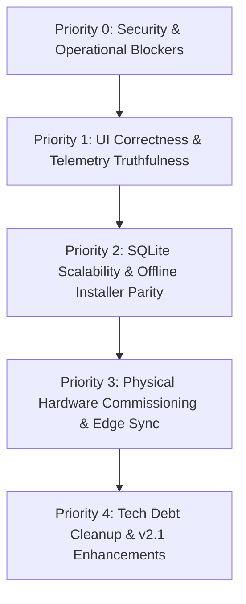

# Development Roadmap & Prioritized Recommendations — LCI-SFM

This roadmap organizes recommended engineering work for **LCI-SFM (`v2.0.0-rc.1` → `v2.0.0` GA and `v2.1`)** by risk, operational impact, and dependency order.

---

## Roadmap Overview

---

## Priority 0 — Immediate Security & Operational Hardening (Pre-`v2.0.0` GA)

These items address security gaps and host/container operational hazards that can cause credential exposure, unauthorized account takeover, or Mosquitto restart failures.

1. **Enforce Current-Password Verification & Session Revocation in Admin Profile Rotation (`TD-01`)**
   - **Target Files**: [schemas.js](file:///opt/lci-sfm/backend/src/validators/schemas.js), [apiRoutes.js](file:///opt/lci-sfm/backend/src/routes/apiRoutes.js), [sqliteRepository.js](file:///opt/lci-sfm/backend/src/repositories/sqliteRepository.js), [backend.test.js](file:///opt/lci-sfm/backend/test/backend.test.js).
   - **Action**: Require `currentPassword` in `adminProfileSchema` (`.strict()`), verify `verifySecret(currentPassword, actor.password_hash)` before updating credentials (returning HTTP `401`/`403` on mismatch), and revoke all other active sessions for that user (`revokeAllSessionsForUser` excluding or rotating the current session).
2. **Protect Provisioned MQTT Credentials & Offline Bundles from Git/Docker (`TD-02`)**
   - **Target Files**: [.gitignore](file:///opt/lci-sfm/.gitignore), [.dockerignore](file:///opt/lci-sfm/.dockerignore), [install.sh](file:///opt/lci-sfm/install.sh).
   - **Action**: Add `mosquitto/provisioned-credentials/`, `dist-release/`, and `project-knowledge/` (if kept local-only, or commit `project-knowledge/` intentionally before running `update.sh`) to `.gitignore` and `.dockerignore`.
3. **Harmonize Mosquitto File Permissions & `update.sh` Ownership Handling (`TD-03`)**
   - **Target Files**: [install.sh](file:///opt/lci-sfm/install.sh), [update.sh](file:///opt/lci-sfm/update.sh), [provision-mqtt-device.sh](file:///opt/lci-sfm/scripts/provision-mqtt-device.sh).
   - **Action**: Ensure `mosquitto/passwd` and `mosquitto/acl` retain container `GID 1883` read access (`chown bedo:1883` + `chmod 0640` on dev hosts, or `1883:1883` `0600` on dedicated appliances) and configure `git config --system/--global --add safe.directory /opt/lci-sfm` in appliance scripts when repository ownership is non-root.

---

## Priority 1 — Functional UI Fixes & Telemetry Truthfulness

Fixes broken operator workflows in the v2 SPA and eliminates synthetic sensor/actuator values before connecting physical hardware.

1. **Fix Physical Credential Masking & Revoke/Block Controls in `/app/users` (`TD-05`)**
   - **Target Files**: [admin.js](file:///opt/lci-sfm/frontend/pages/admin.js), [management.test.js](file:///opt/lci-sfm/backend/test/management.test.js), [ui-e2e.mjs](file:///opt/lci-sfm/scripts/ui-e2e.mjs).
   - **Action**: Render `c.masked_uid` (for RFID) or `'PIN ••••'` (for PIN), and enable **Block** / **Revoke** actions when `c.status === 'ASSIGNED'` (and **Revoke** / **Unblock** if supported when `c.status === 'BLOCKED'`).
2. **Eliminate Fabricated Sensor & Fan State Values in Legacy Telemetry Ingestion (`TD-04`)**
   - **Target Files**: [mqttClient.js](file:///opt/lci-sfm/backend/src/mqtt/mqttClient.js), [schemas.js](file:///opt/lci-sfm/backend/src/validators/schemas.js), [ESP32_FIRMWARE_SPEC.md](file:///opt/lci-sfm/docs/ESP32_FIRMWARE_SPEC.md).
   - **Action**: Stop inventing `smoke -> 650/120` ppm or inferring `fan_relay` at `28°C`. Only pass keys actually reported by the device payload into `operations.ingestLegacy()`, and align any legacy compatibility threshold with the documented `30.0°C` hardware rule.
3. **Fix Simulator Mode Banner & Retire/Harden Legacy User Provisioning (`TD-07`, `TD-08`)**
   - **Target Files**: [landing.js](file:///opt/lci-sfm/frontend/pages/landing.js), [schemas.js](file:///opt/lci-sfm/backend/src/validators/schemas.js), [apiRoutes.js](file:///opt/lci-sfm/backend/src/routes/apiRoutes.js).
   - **Action**: Update `landing.js` to check `Boolean(info?.simulation)` matching `/api/public/info`. Enforce `min(12)` password length on `POST /api/provision/user` (or deprecate it in favor of `/api/v1/operators` + `/api/v1/people`).

---

## Priority 2 — Performance, Scalability & Offline Deployment Parity

Eliminates the synchronous SQLite event-loop bottleneck and brings air-gapped scripts up to parity with online installers.

1. **Batch SQLite Queries in `listDevices()` and Background `tick()` (`TD-06`)**
   - **Target Files**: [releaseOperations.js](file:///opt/lci-sfm/backend/src/services/releaseOperations.js), [operations.test.js](file:///opt/lci-sfm/backend/test/operations.test.js), [load-test.mjs](file:///opt/lci-sfm/scripts/load-test.mjs).
   - **Action**: Replace per-device `this.device(id)` loops with bulk `SELECT` queries across `device_registry LEFT JOIN rooms`, `device_endpoints`, `device_endpoint_state`, `device_observations`, `alarm_rules`, and open `alarms`, assembling device objects in memory in `O(1)` queries (`6` queries total per `tick()` instead of `~1,000+` at 100 devices). Re-run `npm run test:load` to verify sub-100ms p95 API latency at 100+ devices.
2. **Fix Air-Gapped Offline Install/Update Scripts & Docs (`TD-09`)**
   - **Target Files**: [install-offline.sh](file:///opt/lci-sfm/install-offline.sh), [update-offline.sh](file:///opt/lci-sfm/update-offline.sh), [README.md](file:///opt/lci-sfm/README.md).
   - **Action**: Provision `node1_access`, `node2_env`, and `vision_service` in `install-offline.sh`; honor `TLS_ENABLED=true` (`-f docker-compose.tls.yml`) in `update-offline.sh`; update `README.md` `dist-offline/` references to `dist-release/`.

---

## Priority 3 — Hardware Commissioning & Edge Feature Completion

Completes end-to-end physical facility readiness once Priority 0–2 software fixes are verified.

1. **Physical ESP32-S3 Hardware Acceptance & LAN Broker Binding**
   - Bind `MQTT_BIND_IP` (and `FRONTEND_BIND_IP` + `TLS_ENABLED=true` with LAN IP SAN) for the facility VLAN (`192.168.204.x` or dedicated IoT subnet).
   - Flash and commission physical ESP32-S3 nodes (`node1`, `env_02`, `node3`, or `MQTT_V1` dynamic manifest firmware), verifying `boot_id`/`seq` deduplication, LWT offline detection, and physical relay state confirmation.
2. **Edge Physical Credential Policy Sync (`node1`)**
   - Design and implement an authenticated MQTT sync contract (e.g., `lci/v1/d/<device_id>/credentials/sync` + `ack`) to push hashed/authorized RFID UIDs and PIN verifiers from `physical_credentials` to access controllers, adding `'SYNCED'` and `'FAILED'` states to `physical_credentials.sync_status` via migration `005`.
3. **Background Polling for `HTTP_JSON_V1` Devices**
   - Add an async bounded-concurrency scheduler in `ReleaseOperationsService` (respecting SSRF & timeout guards) so `HTTP_JSON_V1` devices poll automatically at a configurable interval rather than relying solely on manual operator `probe` clicks.
4. **Vision / Camera MFA Architecture Decision**
   - Decide whether to introduce a containerized local vision microservice (`vision_service`) + `/ws/mfa` UI toast/camera-log view in `/app/logs`, or formally scope camera support to `CAMERA_JPEG` snapshots in v2.0 and defer facial MFA to v2.1.

---

## Priority 4 — Codebase Hygiene & UX Polish

1. **Expose Existing Backend Capabilities in UI**:
   - Add `retention_days` configuration control (`PUT /api/v1/retention`) to `/app/settings`.
   - Wire `GET /api/telemetry/aggregate` (`1h` / `24h` / `7d` bucketed averages/peaks) into `/app/analytics` for multi-day trends.
   - Add `camera_events` tab to `/app/logs` if MFA events remain supported.
2. **Remove Dead Files & Reconcile Documentation (`TD-10`)**:
   - Remove unreferenced root `facility-console.js`, `release-console.js`, stale `metadata.json`, and obsolete Node-RED markdown files (after user approval).
   - Update `docs/LOCAL_FIRST_ARCHITECTURE.md`, `docs/PROFESSIONAL_LOCAL_PLATFORM_AUDIT.md`, and `CHANGELOG.md` so schema references (`mqtt_identity_status` vs `mqtt_identities`, `condition_type` enum values) match `004_multi_room_platform.sql`.
   - Replace hardcoded file lists in `npm run lint` with automatic directory traversal (`find` or a small Node script) so new `.js`/`.mjs` files are always checked.
