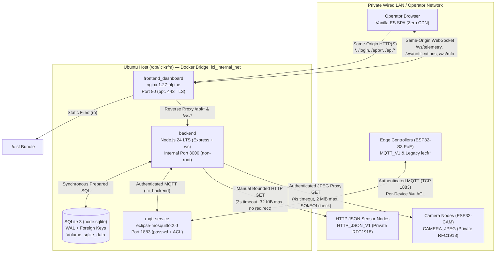

# System Architecture — LCI-SFM (`2.0.0-rc.1`)

## 1. High-Level Component Topology

LCI-SFM strictly separates the **Frontend Reverse Proxy**, **Backend Application Server**, **Embedded Relational Database**, and **MQTT Broker** across isolated containers on an internal Docker bridge network (`lci_internal_net`). Node-RED is **not** part of the architecture.

---

## 2. Frontend Architecture

- **Technologies:** Semantic HTML5 (`index.html`), custom-property CSS (`styles.css`, 2,205 lines), and modular Vanilla JavaScript ES Modules (`app.js`, `frontend/*.js`, `frontend/components/ui.js`, `frontend/pages/*.js`), bundled via **Vite 8** into `dist/`.
- **Zero External Dependencies at Runtime:** No React/Vue/Angular, no Tailwind CDN, no Google Fonts, no external chart libraries. Icons are rendered from an inline `<svg>` `<symbol>` sprite in `index.html`; sparklines, trend history charts, and the interactive network topology graph are built natively using `document.createElementNS('http://www.w3.org/2000/svg', ...)`.
- **Routing (`frontend/router.js`):** Client-side History API (`pushState` / `replaceState` / `popstate`) supporting deep-linking across 2 public routes (`/`, `/login`) and 13 authenticated `/app/*` routes, backed by Nginx `try_files $uri $uri/ /index.html;`.
- **State Management (`frontend/store.js`):** Lightweight pub/sub store (`subscribe`/`notify`) + live event bus (`onLiveEvent`) managing operator session state, CSRF token, Dark/Light theme (`localStorage`), collapsible sidebar state, toast queue, focus-trapped modal & slide-over drawer overlays, Web Audio critical alert synthesizer, and 3 exponential-backoff WebSocket clients (`/ws/telemetry`, `/ws/notifications`, `/ws/mfa`) plus a 20-second `/api/health/ready` + unread count poll.
- **API Client (`frontend/api.js`):** Centralized `fetch` wrapper (`credentials: 'same-origin'`) that automatically attaches `X-CSRF-Token` to all non-`GET`/`HEAD` requests and triggers session-expiry redirect on HTTP `401`.
- **Design System:** Dark Industrial Graphite default (`data-theme="dark"`) with Light Technical Neutral toggle (`data-theme="light"`). Uses a 6-tone semantic indicator system (`ok`, `warn`, `crit`, `info`, `pending`, `muted`) that always pairs icon + color + explicit text label, and `renderAdaptiveCollection()` which renders `.data-table` above `768px` and stacked `.record-card` views on mobile/narrow viewports.

---

## 3. Backend Architecture

- **Runtime & Language:** **Node.js 24 LTS** (`>=22.5.0` required for built-in `node:sqlite`), ES Modules (`"type": "module"`).
- **Framework & Layering (`backend/src/`):**
  - **Entrypoint (`server.js`):** Instantiates backend context, optionally mounts Vite dev middleware or static `dist/` when `SERVE_FRONTEND !== 'false'`, starts MQTT connection and HTTP listener, and handles `SIGINT`/`SIGTERM` graceful shutdown.
  - **Composition Root (`app.js`):** Wires `loadConfig` → `SqliteDatabase` (migrations + one-time Admin bootstrap) → `SqliteRepository` → `AuthMiddleware` → `WsGateway` → `CommandCoordinator` → `MqttService` → `FacilityManagement` → `ReleaseOperations` → Express routers (`/api/v1` operations, `/api/v1` management, `/api` core).
  - **Middleware (`middleware/security.js`, `middleware/auth.js`):** Correlation IDs (`X-Request-Id`), security headers (`X-Content-Type-Options`, `X-Frame-Options`, `Referrer-Policy`, `Cache-Control: no-store` on `/api/*`), allowlisted CORS, bounded in-memory rate limiters, `64kb` JSON body limit, opaque `HttpOnly; SameSite=Strict` session cookies (`lci_sid`), timing-safe `X-CSRF-Token` enforcement on mutations, optional non-prod Bearer token compatibility, and server-side `Admin` / `Viewer` RBAC guards.
  - **Validators (`validators/*.js`):** **Zod v4** schemas enforcing strict field formats, bounds, private RFC1918 unicast IPv4 rules, and transport-conditional requirements.
  - **Services (`services/*.js`):**
    - `ReleaseOperations`: Multi-room CRUD, generic device/endpoint registry, quarantine & manifest drift engine, telemetry ingestion & per-endpoint freshness, deterministic sensor alarm evaluation, `MQTT_V1` switch command dispatch, scoped notifications, 1-second background monitoring `tick()`, and hourly retention cleanup.
    - `FacilityManagement`: Legacy shared 3-node settings sync, occupant directory (`people`), masked RFID & scrypt PIN credentials (`physical_credentials`), operator creation, and 45-second nonce-bound RFID reader enrollment FSM (`reader_enrollment_sessions`).
    - `CommandCoordinator`: Legacy allowlisted actuation workflow (`EMERGENCY_DOOR_UNLOCK`, `TOGGLE_HVAC_FAN`, `TOGGLE_AUX_LIGHT`, `SET_CONTROL_MODE`) with `command_audit` tracking, 150ms fast-ACK wait, 5s timeout, and state confirmation via `/ack` or telemetry.
    - `cameraSnapshot`: SSRF-hardened private LAN HTTP JPEG proxy (`redirect: 'manual'`, 4s timeout, 2 MiB max, JPEG `FFD8`..`FFD9` marker validation).
  - **WebSocket Gateway (`websocket/wsServer.js`):** Attaches `noServer` `ws` instances to HTTP `upgrade` on `/ws/telemetry`, `/ws/notifications`, and `/ws/mfa`, authenticating upgrades via session cookie (or non-prod Bearer/query token), enforcing a 256 KB per-client backpressure cutoff, and disconnecting sockets immediately upon logout, role change, or user deletion.

---

## 4. Database Architecture

- **Engine:** Embedded **SQLite 3** via Node's native synchronous `node:sqlite` (`DatabaseSync`) — zero native C++ npm addons (`better-sqlite3` is not needed).
- **Configuration (`db/database.js`):**
  - `PRAGMA foreign_keys = ON;`
  - `PRAGMA busy_timeout = 5000;`
  - `PRAGMA journal_mode = WAL;` (on file-backed DBs)
  - `PRAGMA synchronous = NORMAL;`
  - Atomic transactions use `BEGIN IMMEDIATE; ... COMMIT / ROLLBACK`.
- **Migrations:** 4 sequential, additive SQL files in `backend/src/db/migrations/` tracked in `schema_migrations` (`001_initial_schema.sql` through `004_multi_room_platform.sql`), totaling **22 tables**, **15+ indexes**, and **5 SQLite `AFTER INSERT`/`AFTER UPDATE` triggers** that automatically populate `notifications` on auth, management, command failure, and system error events.
- **Backup & Restore (`db/backup.js`):** Uses `VACUUM INTO` for consistent online hot backups (`0600` permissions) verified with `PRAGMA integrity_check`, and guarded offline restore with `.pre-restore-*.bak` safety copies and active WAL/SHM refusal checks.

---

## 5. MQTT Broker Architecture

- **Broker:** **Eclipse Mosquitto `2.0`** (`mosquitto/mosquitto.conf`, `mosquitto/acl`, `mosquitto/passwd`).
- **Security:** `allow_anonymous false`, `max_packet_size 65536`, `max_inflight_messages 40`, `max_queued_messages 500`, `persistent_client_expiration 7d`.
- **Identity & ACL Model (`mosquitto/acl`):**
  - `lci_backend`: Subscribes to `lci/v1/devices/+/{telemetry,heartbeat,ack}` and legacy `lecf/...` topics; publishes commands to `lci/v1/devices/+/command`, `lecf/access/command`, `lecf/env/command`, and `lecf/access/enrollment/command`.
  - Legacy fixed identities: `node1_access`, `node2_env`, `vision_service`.
  - Dynamic v1 devices: Mosquitto `pattern` rules bind each device's broker username `%u` to its exact `device_id`, allowing write to `lci/v1/devices/%u/{telemetry,heartbeat,ack}` and read on `lci/v1/devices/%u/command` (preventing cross-device spoofing).
- **Connection Resilience (`mqtt/mqttClient.js`):** Performs pre-connect DNS resolution with bounded exponential backoff (`1s` → `30s`) before invoking `mqtt.connect()`, tracks connection generations to avoid stale subscription callbacks, verifies broker QoS grants (`qos !== 128`), and rejects retained v1 frames (`packet.retain === true`).

---

## 6. Infrastructure & Deployment Architecture

- **Containers (`docker-compose.yml`):**
  1. `frontend_dashboard` (`nginx:1.27-alpine`, container `lci_frontend`): Mounts `./dist` (`:ro`) and `./nginx/nginx.conf` (`:ro`). Publishes `${FRONTEND_BIND_IP:-127.0.0.1}:${FRONTEND_PORT:-80}:80` (plus `:443` via `docker-compose.tls.yml`). Blocks dotfiles and `.db|.sqlite|.sql|.env|.yml|.md|.sh|.conf` paths with `404`.
  2. `backend` (`lci-sfm-backend:2.0.0-rc.1` from `node:24-alpine`, container `lci_backend`): Runs as `USER node`, `SERVE_FRONTEND=false`, `TRUST_PROXY=1`, mounts `sqlite_data:/app/data`. Internal port `3000` only (not published to host). Healthcheck polls `http://127.0.0.1:3000/api/health/live` every `15s`.
  3. `mqtt-service` (`eclipse-mosquitto:2.0`, container `lci_mqtt_broker`): Mounts `mosquitto.conf`, `acl`, `passwd` (`:ro`) and `mosquitto_data:/mosquitto/data`. Publishes `${MQTT_BIND_IP:-127.0.0.1}:${MQTT_PORT:-1883}:1883`.
- **Host Tooling:** `install.sh` (discovery + Q1–Q6 interactive setup), `update.sh` (flock-serialized worktree test + `VACUUM INTO` backup + rollback trap), `install-offline.sh` / `update-offline.sh` + `scripts/build-offline-bundle.sh` (air-gapped OCI tarball deployment), `scripts/configure-static-ip.sh` (`netplan try`), `scripts/setup-local-tls.sh` (local CA + SAN cert), and `scripts/provision-mqtt-device.sh` (`mosquitto_passwd` + `SIGHUP` reload).
